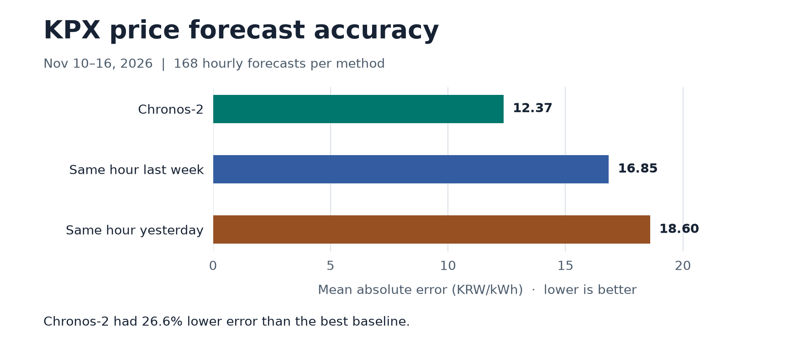
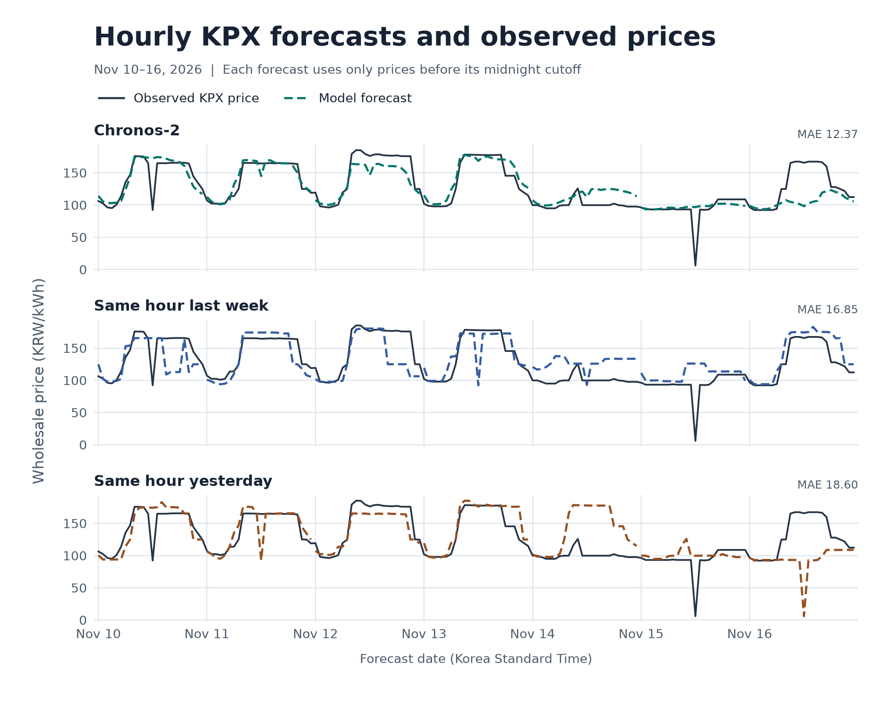

# EnergyPilot: AI-Based Forecasting for a Proactive Energy-Saving Home

**ITE351 AI & Applications – Group 12 (AI + SE)**

## Contents

- [Group members](#group-members)
- [I. Introduction](#i-introduction)
- [II. Datasets](#ii-datasets)
- [III. Methodology](#iii-methodology)
- [IV. Evaluation & Analysis](#iv-evaluation--analysis)
- [V. Related Work](#v-related-work)
- [VI. Conclusion: Discussion](#vi-conclusion-discussion)

**Video or audio recording:** Link pending.

## Group members

| Name | University | Email |
|---|---|---|
| Filip Kadmark | Hanyang University | filipkadmark@gmail.com |
| Philip Dahlensjö | Hanyang University | philip.dahlensjo@gmail.com |
| Jasmin Hansson | Hanyang University | jassehansson2014@gmail.com |
| Lucas Roy-Picard | Hanyang University | lucas.roy-picard.1@ens.etsmtl.ca |

## I. Introduction

Electricity prices change during the day, but most households run their washing machine, dryer and dishwasher whenever it suits them, often when power is most expensive. Moving these flexible loads to cheaper hours lowers the bill and eases the load on the grid, but doing it by hand takes effort.

Our idea is part of EnergyPilot, our combined AI + SE project on a proactive agentic home. In the AI part, we want to explore how machine learning can predict electricity prices and a household's energy use for the coming day. Using public price and household consumption data, we will analyze the patterns step by step and compare a few forecasting methods. The predictions can then help decide when appliances should run, and show how much a household could save.

## II. Datasets

The price backtest uses South Korean mainland wholesale electricity prices from the Korea Power Exchange (KPX). We selected household electricity measurements from France for a separate usage forecast.

| Dataset | Coverage | Fields we plan to use |
|---|---|---|
| [KPX hourly System Marginal Price (SMP), converted to 15-minute slots](ai/data/kpx/prices_15min.csv) | Mainland South Korea, January 1, 2024 to November 16, 2026, with 100,896 slots | The `start` column gives the beginning of each slot and `price` gives the wholesale SMP in KRW/kWh. |
| [Household Electric Power Consumption](https://www.kaggle.com/datasets/uciml/electric-power-consumption-data-set) | 2,075,259 one-minute records from one household in Sceaux, France, December 2006 to November 2010 | `Date` and `Time` identify each reading. `Global_active_power` gives whole-home active power in kW. `Sub_metering_1` and `Sub_metering_2` give energy in Wh for the kitchen and laundry circuits. Each circuit serves several devices. [Original UCI dataset](https://archive.ics.uci.edu/dataset/235/individual+household+electric+power+consumption) |

For the **price forecast**, we use wholesale SMP as the target. The conversion script reads the hourly KPX export from EPSIS and copies each hourly value into the four 15-minute slots within that hour. The backtest forecasts and evaluates at the source's hourly resolution. [KPX conversion script](ai/convert_kpx.py)

**Why the scheduler uses 15-minute slots.** The demo scheduler checks appliance start times in quarter-hour steps and requires each run to finish by its deadline. Quiet hours are part of the specification and are pending in the demo. A 45-minute wash starting at 15:45 uses the 15:00 hourly rate for its first slot and the 16:00 hourly rate for its next two slots. The scheduler multiplies each slot's rate (KRW/kWh) by the energy used in that slot (power in kW × 0.25 hours), then adds the slot costs. [EnergyPilot specification](EnergyPilot_A_B.pdf)

For the **household usage forecast**, we will combine `Date` and `Time`, flag hours with incomplete readings, and sum the minute-average active power readings divided by 60 to obtain hourly consumption in kWh. The circuit measurements will help us explore when kitchen and laundry loads are typically active.

The datasets cover different places and years, so we will forecast and evaluate each series separately. The scheduling demo will use the KPX wholesale prices to estimate the cost of simulated appliance runs in KRW. The household data represents a single home, and retail savings would depend on the customer's tariff and appliance use.

## III. Methodology

### Forecasting model

We used Amazon Chronos-2, a pretrained transformer for time-series forecasting, through the `amazon/chronos-2` checkpoint and the `chronos-forecasting` package. It can forecast the next 24 hours from price history alone, which lets us test it without training or fine-tuning on KPX data. For each cutoff in this backtest, the model used the most recent 8,192 hourly prices, about 341 days. [Chronos-2 implementation](ai/chronos_2.py)

### Inputs and predictions

- **KPX prices.** We take one observation per hour from the 15-minute CSV. We pass the timestamped SMP history to `Chronos2Pipeline.predict_df` and keep the median prediction for each of the next 24 hours.
- **Household usage.** Use the hourly whole-home consumption series in kWh. First forecast from that history alone, then test whether past kitchen and laundry circuit readings improve the next 24 hourly predictions.
- **Scheduler input.** The forecasting code returns `start` and `price`. The `to_15min()` function repeats each hourly forecast across four quarter-hour slots in the scheduler's input format. The current demo still loads a synthetic tariff. [Demo integration issue](https://github.com/PhilipDahlensjo/SE-AI_project/issues/24)

### Seasonal baselines

We compare Chronos-2 with two seasonal baselines. One repeats the prices from the same hour yesterday to capture daily patterns. The other repeats the prices from the same hour last week to capture differences between weekdays and weekends. [Baseline implementation](ai/baseline.py)

## IV. Evaluation & Analysis

### KPX price forecast results

We compared Chronos-2 with both seasonal baselines on November 10–16, 2026. At midnight each day, each method forecast the next 24 hourly wholesale prices using only prices recorded before that cutoff. We compared all 168 forecasts per method with the observed KPX prices. Lower mean absolute error (MAE) means a more accurate price forecast.

| Forecast method | MAE (KRW/kWh) |
|---|---:|
| Same hour yesterday | 18.60 |
| Same hour last week | 16.85 |
| Chronos-2 (median forecast) | **12.37** |

Chronos-2 reduced MAE by about 27% compared with the same-hour-last-week baseline, the stronger baseline that week. The hourly plots show where the models struggled. For example, Chronos-2 missed the one-hour drop to 5.98 KRW/kWh at noon on November 15. The same-hour-yesterday baseline carried that drop into its forecast for November 16. [KPX hourly SMP table](https://epsis.kpx.or.kr/epsisnew/selectEkmaSmpShdGrid.do?locale=eng&menuId=050202)

We generated both figures in Python with Matplotlib. We matched the hourly predictions from the seven-day backtest to the observed KPX prices by timestamp, then averaged the absolute errors for the bar chart. In the line chart, the solid line shows observed prices and each dashed segment shows one 24-hour forecast.

## V. Related Work

- Chronos-2 is a pretrained model for forecasting time series. We use its published checkpoint and pandas inference API. [Amazon Chronos-2 model card](https://huggingface.co/amazon/chronos-2)
- Our benchmarks follow the seasonal naïve approach described by Hyndman and Athanasopoulos in *Forecasting: Principles and Practice*. [Forecasting reference](https://otexts.com/fpp3/)
- KPX publishes the wholesale prices through EPSIS. The UCI Machine Learning Repository documents the household power measurements selected for the usage forecast. [KPX EPSIS](https://epsis.kpx.or.kr/epsisnew/selectEkmaSmpShdGrid.do?locale=eng&menuId=050202) · [UCI data documentation](https://archive.ics.uci.edu/dataset/235/individual+household+electric+power+consumption)

## VI. Conclusion: Discussion

Chronos-2 had the lowest hourly price error in this seven-day evaluation. To compare the methods for scheduling, we still need to price their recommended appliance runs using the observed KPX rates. The household usage forecast also needs a separate evaluation in kWh.
